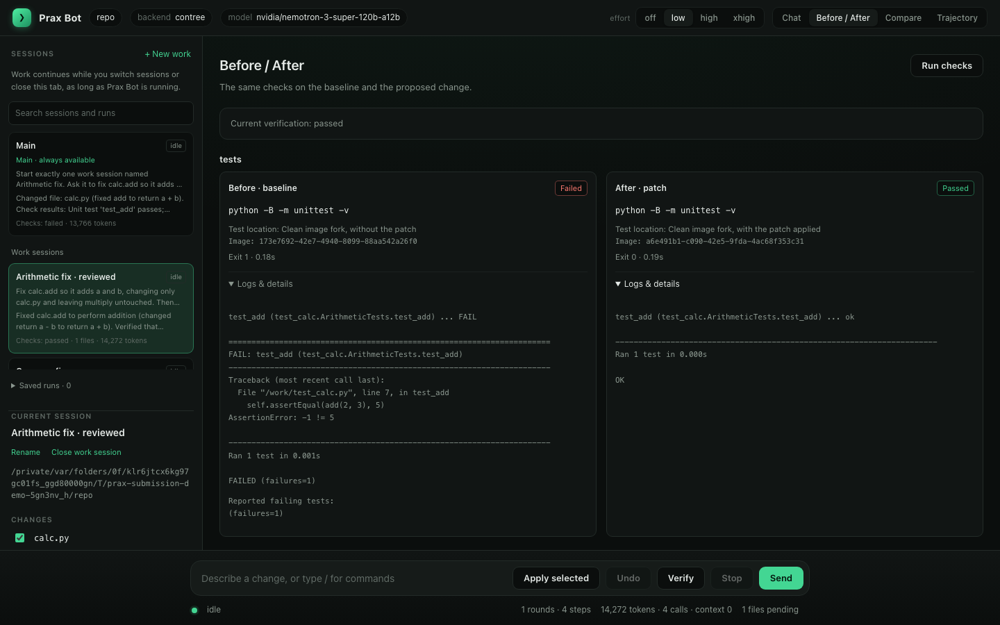

# Prax Bot

A coding agent that works inside a [Nebius Token Factory Sandbox](https://docs.tokenfactory.nebius.com/sandboxes/overview), powered by [NVIDIA Nemotron](https://nebius.com/services/token-factory/nemotron) on Token Factory.

Give it a task in a git repository. By default it uploads the repository into an isolated sandbox, then reads, edits, and runs commands there. Configure test and lint commands to check its work after each round. At the end you see the results and a diff, and decide which files to apply. An optional local backend runs commands on your machine for development.

Built for the Nebius x NVIDIA Global AI Hackathon, Track 1: agents that write, run, and test code in Token Factory Sandboxes.

## Requirements

- Python 3.12 and [uv](https://docs.astral.sh/uv/)
- A Nebius account with Token Factory access
- `NEBIUS_API_KEY`: your Token Factory API key. It also authenticates Sandboxes.
- `NEBIUS_PROJECT_ID`: your Nebius project id. Sandboxes require it.

## Install

```bash
uv sync
uv run prax doctor
```

`doctor` checks the credentials, lists the `nvidia/` models your key can reach, proves a tool-call round trip with the configured model, and runs a command in a sandbox, including a fork-isolation check. Add `--skip-sandbox` to test only the model.

Credentials can also live in the sandbox SDK's own file, `~/.config/contree/auth.ini`, which `contree auth -P <project id>` writes for you (`uv tool install contree-cli`). Prax Bot reads the `token` and `project` lines from the active profile.

Sandboxes are in beta and access is granted per project. If `doctor` reports a 403, request access at https://tokenfactory.nebius.com/sandboxes/about and use `--backend local` in the meantime.

## Quick start

```bash
make setup     # install dependencies
make doctor    # check the key, the project, the model and the sandbox
make web       # open the web interface on this repository
make demo      # try it with no sandbox: a throwaway repo with a failing test, run on this machine
```

`make` alone lists every command. To get a plain `prax` command on your PATH, run `make install` (it uses `uv tool install --editable .`, which puts a `prax` shim in `~/.local/bin` and touches no shell config). `praxbot` is the same command under its long name.

## Use

Inside any git repository, either open a session:

```bash
uv run prax
```

or give it one task:

```bash
uv run prax run "fix the failing test in tests/test_cache.py" --setup "pip install -e . pytest"
```



Bare `praxbot` opens the web interface on localhost and points a browser at it. One page holds the whole session: a Chat view with each instruction, its tool calls grouped and expandable, the model's summary, and a foldable diff; a Trajectory view with the raw log; a sidebar with the session, the files changed so far, the to-dos and the rounds; and a slash-command menu when you type `/`. It binds to localhost with a token in the URL, and `--no-browser` prints the URL instead of opening one. Events stream to the page as they happen; there is nothing to install in the browser.

For a terminal instead of a browser there are two other front ends on the same session: `praxbot ui`, a full-screen terminal interface, and `praxbot session`, a plain prompt for pipes and scripts. A session opens one sandbox and keeps taking instructions. Each one continues from the current state, and the diff is shown after every instruction. `praxbot session --backend local --effort low` opens one with options.

| Session command | Effect |
|---|---|
| `/diff` | Show pending changes and paths excluded by Git ignore rules |
| `/apply [PATH ...]` | Apply all pending files, or only the named files; quote paths containing spaces |
| `/undo` | Restore the workspace and task context to before the last round |
| `/goal [--check CMD] [--rounds N] OBJECTIVE` | Work in rounds toward an objective |
| `/resume RUN-ID [--from N]` | Load a checkpoint from the same repository and backend; use `prax resume RUN-ID` to open a different repository |
| `/effort LEVEL` | Change reasoning effort while preserving the other settings |
| `/verify` | Run the configured test and lint commands |
| `/stop` | Stop after the current model or tool call finishes |
| `/status` | Show usage, verification status and pending changes |

The web sidebar has file checkboxes and an **Apply selected** button. Files left unselected remain pending. The **Stop** button works while a request is running; the terminal UI uses F5 for Stop and F6 for Verify. In a plain terminal, Ctrl+C interrupts the current round. Stopping saves the latest completed checkpoint and pending diff. A call already in progress must finish or time out before the web or terminal UI can stop.

Applying refreshes the diff first, saves the patch and the affected files' before/after fingerprints, then updates the working tree and workspace baseline. If interrupted, retry `/apply` or reopen that run's latest checkpoint to recover. Recovery recognizes an already applied patch; if the files match neither recorded state, it preserves them and reports the conflict. `/undo` applies only to rounds since the last apply.

`prax status` shows current status, the last recorded state, and the age of the event log separately. A process-held event-log lock establishes that a session is live. A stopped writer cannot leave a run permanently “in progress”; older runs without this tracking report unknown activity.

What happens in a run:

1. The working tree (tracked and untracked files, respecting `.gitignore`) is uploaded into a fresh sandbox built from `python:3.12` and committed there as the baseline.
2. The optional `--setup` command runs once, for dependencies.
3. Nemotron works through a small tool set: `list_files`, `search`, `read_file` (a region, or one function or class whole by name), `outline`, `edit_file`, `write_file`, `run`, `restore`, `finish`. Every `run` and every edit produces a new immutable sandbox image, which is a checkpoint the model can `restore`.
4. When the model calls `finish`, or the step budget ends, configured test/lint commands run against the current checkpoint. Their results and the diff against the baseline are shown.
5. You can type a follow-up instruction ("also handle the negative case"). The agent continues in the same sandbox, with the original task, its previous summary and the diff so far as context, and shows the new diff. Press Enter to stop.
6. You choose whether to apply the diff. Applying changes the working tree only; nothing is committed.

Options:

| Flag | Default | Meaning |
|---|---|---|
| `--model` | `nvidia/nemotron-3-super-120b-a12b` | Any model id on Token Factory |
| `--base-image` | `python:3.12` | OCI image for the sandbox; it needs `git` and `tar` |
| `--setup` | none | Shell command run once after upload |
| `--test-command` | none | Test command run by the harness after each round |
| `--lint-command` | none | Lint command run by the harness after each round |
| `--max-steps` | 40 | Model turns before the run stops |
| `--backend` | `contree` | `contree` runs in a Token Factory Sandbox. `local` runs on this machine in a private virtualenv, for development only |
| `--investigate-model` | none | A second model for the first investigation turns, for example Nemotron 3 Ultra, before switching to `--model` for edits |
| `--temperature`, `--top-p` | 1.0, 0.95 | Sampling, NVIDIA's recommendation for Nemotron 3. Runs 1 to 10 and the frozen-harness SWE-bench runs used 0.2 |
| `--effort` | low | How much the model reasons per step: off, low, high (the model's default, used by the frozen-harness runs), xhigh (a 32k completion cap) |
| `--yes` | off | Apply without asking |
| `--export PATH` | none | Also write the diff to a file |
| `--verbose` | off | Full tool outputs and checkpoint ids |

Environment variables `PRAXBOT_MODEL`, `PRAXBOT_TEMPERATURE`, `PRAXBOT_TOP_P`, `PRAXBOT_EFFORT`, `PRAXBOT_BASE_IMAGE`, `PRAXBOT_SETUP`, `PRAXBOT_TEST_COMMAND`, `PRAXBOT_LINT_COMMAND`, `PRAXBOT_MAX_STEPS`, `PRAXBOT_COMMAND_TIMEOUT`, `PRAXBOT_SETUP_TIMEOUT`, `PRAXBOT_IMPORT_TIMEOUT`, and `PRAXBOT_HOME` set the same things.

### Config files

Anything you would otherwise type as a flag every time can live in a file. Two files are read:

| File | For | May set |
|---|---|---|
| `~/.praxbot/config.toml` | you | model, effort, backend, base_image, setup, test_command, lint_command, max_steps, temperature, top_p, investigate_model, investigate_steps, context_budget, timeouts, llm_base_url, system_prompt_file |
| `<repo>/.praxbot/config.toml` | one repository, committed with it | model, effort, base_image, setup, test_command, lint_command, max_steps, temperature, top_p, investigate_model, context_budget |

Precedence, highest first: a flag, a `PRAXBOT_*` environment variable, the repository's file, your file, the default. `prax config` prints every setting with where it came from; `prax config --init` and `prax config --init-repo` write starter files in which every line is a comment.

The usual reason for a repository file is the setup command, so nobody has to remember it:

```toml
# .praxbot/config.toml
setup = "pip install -e . pytest"
base_image = "python:3.12"
test_command = "python -m pytest -q"
# lint_command = "ruff check ."  # install the project's linter during setup
```

The repository file cannot choose the backend or the model endpoint. Setup and verification commands it provides only run inside a sandbox. On the local backend they are ignored with a notice; pass `--setup`, `--test-command`, or `--lint-command` yourself, or configure them through your own environment or user config.

### Verification

The harness runs each configured check independently of the model, in a disposable copy of the current checkpoint. Commands start at the repository root and use `command_timeout`. Their output tail, exit code, elapsed time and tested image are saved in `run.json` and shown in the web interface and HTML reports. Check-created files do not become repository changes.

**Agent finished** means the model called `finish`. **Checks passed** means every configured command exited successfully on the displayed checkpoint. Missing configuration, checks that have not run, incomplete checks, failures, and results from an older checkpoint have distinct statuses. Passing configured checks establishes only what those commands cover. `run`, `resume` and `goal` return a nonzero exit code for failed or incomplete checks; cancellation returns 130. Goal completion requires all configured checks to pass, and an identical `--check` command is reused instead of run twice. Model errors and cancellation stop the goal before success is considered. Applying creates a new baseline checkpoint, so the saved evidence becomes stale; the command's exit status reflects verification before applying.

### Prompts

Prompt templates ship under `src/prax_bot/core/prompts/`, one text file per prompt, with `{placeholders}` filled in by the caller. They cover the core engineering rules, code style, execution environment, verification plan, compaction summary, budget reminders, continuation and goal texts, protected-file guidance, and tool descriptions.

Each round's system message combines the core rules, code style, the active workspace's environment, and its verification plan. The environment describes the actual backend and working directory, including the local backend's virtual `/work` root and shell scratch path (`"$TMPDIR/praxbot/scratch"`). Creating a local scratch file also returns its quoted shell path. The plan lists the checks scheduled after `finish`; when none are scheduled, it explicitly assigns relevant verification to the agent. These instructions stay in the system message through context compaction.

```bash
prax prompt --list          # every prompt and where each comes from
prax prompt                # the core system rules, before runtime context is appended
prax prompt tools/restore   # any other one by name
prax prompt --path system   # where it comes from
```

To change one, put a file with the same name under `~/.praxbot/prompts/`, for example `~/.praxbot/prompts/system.md` or `~/.praxbot/prompts/tools/run.md`, and it replaces the packaged text; `system_prompt_file` in the config does the same for the core rules by pointing at any file. Replacing the core rules still appends code style, environment and verification; an empty `code_style.md` override omits the style section. Only your own configuration can do this: a repository's config may not set it, because a cloned repository must not choose what the model is told. Rules that belong to a project go in its `AGENTS.md`, which the model reads at the start of every run.

The core rules ask for reproductions on bug reports when possible and checks suited to features, refactors, documentation and read-only tasks. Failures stay unresolved until investigated: calling one pre-existing requires baseline evidence, and calling a test expectation obsolete requires an explicit conflicting requirement. The agent preserves supported changes, avoids speculative abstractions, and distinguishes observed results from pending runtime checks in `finish`. Budget reminders follow the same rules. This revision corrects prompt and runtime inconsistencies; [small behavior smoke checks](bench/prompt-smoke/20260910.md) did not establish a comparative gain. A controlled model benchmark is still needed to measure effects on solve rate or token use. The benchmark results below describe the versions measured at the time.

## How the context is managed

Every model call resends the whole transcript, so on a long task the cost per step grows with everything that came before. Three things keep it in check, in order of how much they cost:

1. **Tool results age out.** The six most recent results stay complete. Older ones lose their middle, first to about 4,000 characters, then to about 1,000, and past that a result becomes a one-line digest of what it was. This runs before every call.
2. **A hard character cap** on the transcript still applies as a backstop.
3. **Summarising compaction.** When the context the last call sent passes the budget, the model writes a summary of the work so far, with every file, function, checkpoint and test result named, and the transcript becomes: the system prompt, the task and project instructions, that summary, and the last three turns verbatim. The workspace is untouched; only what the model remembers changes. At most once every six steps.

The budget is a setting: `--context-budget`, `PRAXBOT_CONTEXT_BUDGET`, or `context_budget` in a config file, 80,000 tokens by default. `/status`, the terminal status line and the web status bar show the size of the last call's context, and a compaction is reported when it happens. The size is the real one, read from the API's usage figures, not an estimate.

## How the sandbox is used

Token Factory Sandboxes are immutable images. Running a command on an image produces a new image. Prax Bot keeps the current image as the workspace state: mutating commands and file writes advance it, read-only commands run disposably and leave it alone. That gives free checkpoints, an exact record of every state the agent passed through, and a diff that is computed inside the sandbox with git. Build artifacts such as `*.egg-info/`, `__pycache__/`, and `.pytest_cache/` are kept out of the diff through the workspace's `.git/info/exclude`. New tests and binary files are included unless Git ignores them. Ignored paths are listed separately so you can review what was excluded. Throwaway reproduction scripts belong in `/tmp/praxbot/scratch`, outside the repository; a new root-level file named like one (`reproduce.py`, `debug_*.py`, `test_*.py`) or a new binary file stays in the diff but is flagged, and an apply leaves it out unless you name it.

The local backend implements the same workspace contract over a temporary directory: commands run with a scrubbed environment inside a private Python 3.12 virtualenv, and checkpoints are directory clones. It is convenient for development and it is not isolation: model-generated commands execute on your machine.

## A first run

Against a small package with two seeded bugs and four tests, Nemotron 3 Super listed the files, read the code and the tests, ran pytest, made two edits, re-ran pytest until it passed, and called finish. The diff touched one file. Numbers from runs of that task:

| | Token Factory Sandbox | local backend |
|---|---|---|
| model turns | 11 | 14 |
| tokens | 38k | 67k |
| commands and checkpoints | 7 and 7 | 6 and 7 |
| baseline ready after | 2.2 s plus a 3.4 s `pip install` | 0.1 s plus 3.5 s |
| wall time | 93 s | 57 s |

Every sandbox command is one immutable image; the run above went from baseline image `27269190…` to final image `d6afd5b8…` through seven checkpoints, and the diff was computed by git inside the sandbox.

## Limits

- One project type is tested: Python repositories using pytest. Other languages work if the base image has their toolchain.
- Commands are stateless between calls. A background server started in one `run` is gone by the next.
- The sandbox has network access, so a prompt injection inside a repository could exfiltrate repository contents. No credentials are ever placed in the sandbox.
- Configured verification checks run independently of the model, on the workspace it edited. They cover only the commands you configure; they are not a hidden or protected test suite.

## Benchmark

`bench/` holds five seeded regressions in real Python libraries, each verified to fail at the bugged commit and pass at HEAD. `scripts/bench.py` runs the agent on each one in a sandbox and judges the exported diff independently: it is applied to a fresh copy of the bugged repository in a new sandbox, a broader test set than the one the agent was told about is run, and any change to a test file counts as a failure.

```bash
uv run python scripts/bench.py --src /path/to/clones --validate   # HEAD passes, bug fails
uv run python scripts/bench.py --src /path/to/clones              # run and judge
```

Four runs with Nemotron 3 Super, 40-step budget, the harness improving between runs as the failures were diagnosed:

| task | run 1 | run 2 | run 3 | run 4 | run 5 |
|---|---|---|---|---|---|---|
| toolz-sliding-window | fail, 40 steps | pass, 12 | pass, 15 | pass, 17 | pass, 8 |
| more-itertools-tail | pass, 9 | pass, 8 | pass, 8 (judged on retry) | pass, 12 | pass, 6 |
| tabulate-padding | pass, 24 | fail, 40 | fail, 40 | fail, 35 | pass, 25 |
| humanize-naturalsize | pass, 13 | pass, 7 | pass, 11 | pass, 10 | pass, 12 |
| jmespath-prefix-suffix | pass, 10 | pass, 7 | pass, 7 | pass, 6 | pass, 5 |
| tokens for the run | 1.47M | 1.26M | 1.05M | 1.12M | 0.63M |

What the runs taught the harness, in order: exact-match editing rejected a one-space indentation difference and cost a whole run, so edits now tolerate whitespace and show the closest region on a miss (run 2); replies without a tool call no longer consume the step budget, invalid regexes fall back to literal search, and old tool output is compacted sooner (run 3); there is an `outline` tool for large files and repeated identical calls are caught even when interleaved (run 4); and every run now starts with a repository map of definitions and line numbers, ranked toward the files the task mentions, while compaction keeps a short summary of old tool output instead of dropping it (run 5). The fifth task, a padding bug in a 3,000-line module, failed three times in a row on navigation and passed in run 5 at half the cost of its only earlier pass.

The benchmark then grew to ten tasks, adding click, jinja, packaging, pyparsing, and tomli, which are larger codebases of 1,100 to 35,000 lines:

| task | run 6 | run 7 | run 8 | run 9 | run 10 |
|---|---|---|---|---|
| toolz-sliding-window | pass, 16 steps | pass, 10 steps | pass, 12 steps | pass, 12 steps | pass, 20 steps |
| more-itertools-tail | pass, 8 steps | pass, 10 steps | pass, 9 steps | pass, 7 steps | pass, 8 steps |
| tabulate-padding | fail, 33 steps | pass, 35 steps | fail, 40 steps | pass, 25 steps | fail, 40 steps |
| humanize-naturalsize | pass, 5 steps | fail, 40 steps | pass, 8 steps | pass, 7 steps | pass, 11 steps |
| jmespath-prefix-suffix | pass, 5 steps | pass, 6 steps | pass, 6 steps | pass, 6 steps | pass, 7 steps |
| click-intrange-clamp | pass, 13 steps | pass, 12 steps | pass, 9 steps | pass, 9 steps | pass, 10 steps |
| jinja-batch-filter | pass, 10 steps | pass, 22 steps | pass, 8 steps | pass, 8 steps | pass, 7 steps |
| packaging-canonicalize | pass, 8 steps | pass, 7 steps | pass, 7 steps | pass, 8 steps | pass, 9 steps |
| pyparsing-lineno | fail, - steps | pass, 8 steps | pass, 13 steps | pass, 9 steps | pass, 8 steps |
| tomli-unicode-escape | fail, 7 steps | pass, 7 steps | pass, 5 steps | pass, 7 steps | pass, 8 steps |
| passed | 7/10 | 9/10 | 9/10 | 10/10 | 9/10 |
| tokens for the run | 1.18M | 2.22M | 1.45M | 1.05M | 1.52M |

Run 6's misses: tabulate again, a 14 MB upload that hit the SDK's ten-second request timeout (fixed: 180 s), and a correct tomli fix whose diff extraction hit a transient API error (fixed: retries; the recovered diff passes). Run 7's single miss was a bug in the whitespace-tolerant editor that re-indented an inserted line by the wrong offset and broke the module (fixed, with a regression test). Run 8, on the fixed editor, missed only tabulate. Run 9 added ideas taken from DeepSeek Harness, full command output saved to a file with the tail returned, a read-before-edit guard, a todo tool, and a step counter on every result, and passed all ten, though tabulate has flipped before and stands at four passes in nine attempts with Nemotron 3 Super. Run 10, after the changes made for SWE-bench (file protection only for existing files, staleness by content, a 16k completion cap), passed nine; tabulate flipped back to a miss at 40 steps with no diff, and the nine passes together cost 0.89M tokens.

One attempt of the tabulate task with Nemotron 3 Ultra, before the repository map existed, passed in 35 steps and 836k tokens. `--investigate-model` routes the first investigation turns to one model and the rest to another; the effect is not yet measured.

These are synthetic bugs chosen by us. The numbers are a check on the harness, not a score comparable to SWE-bench.

### Sampling and effort

NVIDIA's guidance for Nemotron 3 Super is temperature 1.0 and top_p 0.95 for every task; runs 1 to 10 used 0.2. The model also reasons before every reply by default, and Token Factory honours the flags that turn reasoning off or shorten it (its reasoning budget is accepted and ignored, so there is no medium level). The suite was run once at the recommended sampling settings for each effort level, against run 10 at the old settings:

| task | run 10 (0.2, effort high) | 1.0/0.95, effort high | 1.0/0.95, effort low | 1.0/0.95, effort off |
|---|---|---|---|---|
| toolz-sliding-window | pass, 20 steps | pass, 13 steps | pass, 8 steps | pass, 14 steps |
| more-itertools-tail | pass, 8 steps | pass, 9 steps | pass, 7 steps | pass, 8 steps |
| tabulate-padding | fail, 40 steps | fail, 40 steps | fail, 40 steps | pass, 21 steps |
| humanize-naturalsize | pass, 11 steps | pass, 6 steps | pass, 5 steps | pass, 10 steps |
| jmespath-prefix-suffix | pass, 7 steps | pass, 5 steps | pass, 5 steps | pass, 10 steps |
| click-intrange-clamp | pass, 10 steps | pass, 13 steps | pass, 8 steps | pass, 14 steps |
| jinja-batch-filter | pass, 7 steps | pass, 8 steps | pass, 5 steps | pass, 9 steps |
| packaging-canonicalize | pass, 9 steps | pass, 7 steps | pass, 7 steps | pass, 9 steps |
| pyparsing-lineno | pass, 8 steps | pass, 22 steps | pass, 10 steps | pass, 28 steps |
| tomli-unicode-escape | pass, 8 steps | pass, 8 steps | pass, 5 steps | pass, 6 steps |
| passed | 9/10 | 9/10 | 9/10 | 10/10 |
| tokens for the run | 1.52M | 1.84M | 1.33M | 1.52M |
| tokens for the passes | 0.89M | 0.98M | 0.52M | 1.52M |

At the recommended sampling settings every level matched or beat run 10, and the tabulate miss is the same task as always: it took 40 steps and about 0.8M tokens at both high and low, and passed at off in 21. Effort off's jinja run first died on a 504 from the sandbox gateway before the agent's first step (which is why workspace creation now retries); the re-run passed in 9 steps and is what the table shows. Low is the cheapest by a wide margin, five to ten steps per pass, and off solved everything but spent up to 28 steps on trial and error where reasoning takes eight. One run each, so the levels are within a task of each other; the cost difference is not.

## SWE-bench Verified subset

`scripts/swe_bench.py` runs the agent on SWE-bench Verified tasks. SWE-bench publishes one environment image per task with the repository at the issue's base commit and its dependencies installed; the sandbox imports those images directly, so no per-repository setup is needed. The agent sees only the issue text, works in a fork of the task image, and its diff is graded in a fresh fork with the dataset's own evaluation script and the official `swebench` harness, hidden tests included.

```bash
uv run python scripts/swe_bench.py list --difficulty "<15 min fix" --per-repo 2 --n 12
uv run python scripts/swe_bench.py run --ids <comma-separated instance ids> --max-steps 50 --parallel 2
```

Twelve tasks rated "under 15 minutes", at most two per repository, chosen with a fixed seed, Nemotron 3 Super, 50-step budget:

| instance | repo | resolved | steps | tokens |
|---|---|---|---|---|
| django__django-11880 | django/django | yes | 21 | 261k |
| django__django-16899 | django/django | yes | 20 | 211k |
| matplotlib__matplotlib-25122 | matplotlib/matplotlib | yes | 50 | 753k |
| psf__requests-1142 | psf/requests | yes | 40 | 554k |
| psf__requests-5414 | psf/requests | yes | 36 | 651k |
| pydata__xarray-4075 | pydata/xarray | yes | 20 | 312k |
| pytest-dev__pytest-5809 | pytest-dev/pytest | yes | 13 | 190k |
| scikit-learn__scikit-learn-12585 | scikit-learn/scikit-learn | yes | 22 | 313k |
| matplotlib__matplotlib-23476 | matplotlib/matplotlib | no | 48 | 1274k |
| sphinx-doc__sphinx-8621 | sphinx-doc/sphinx | no (no diff) | 12 | 166k |
| sympy__sympy-15017 | sympy/sympy | no | 37 | 799k |
| sympy__sympy-20916 | sympy/sympy | no | 28 | 633k |
| **8 of 12 resolved** | | | | 6.1M total |

Before the subset, one pipeline trial on requests-2317 ran on an earlier harness and failed: the model made the correct edit three times but kept restoring to the baseline after seeing unrelated, network-dependent test failures. That trial led to the restore cap and the pre-existing-failure notes.

The four failures were then traced. Two were the harness: leftover reproduction scripts had gone into the diff, and a test file had been edited despite the instruction not to; both are now prevented (scratch files live outside the repository, a new root-level file named like one is flagged and left out of an apply unless named, and test paths can be protected). A third was the harness stalling a run after two blank replies; blank replies are now retried and `finish` is forced only after three stalls. Retried on the fixed harness, sympy-15017 and sphinx-8621 resolved. sympy-20916 produced the same one-line fix as the gold patch except `[0-9]` where the hidden test needs `\d`, and matplotlib-23476 was diagnosed in the wrong file both times; those two are the model's.

The same twelve tasks were then run twice more from scratch, with no retries, to measure the harness rather than the best of several attempts:

| instance | first pass | clean run, round-10 harness | clean run, round-11 harness | clean run, round-12 harness |
|---|---|---|---|---|
| django__django-11880 | yes, 21 | yes, 46 | yes, 22 | yes, 40 |
| django__django-16899 | yes, 20 | yes, 50 | yes, 46 | no (no diff), 31 |
| matplotlib__matplotlib-23476 | no, 48 | no, 50 | no, 50 | no, 50 |
| matplotlib__matplotlib-25122 | yes, 50 | yes, 39 | yes, 49 | yes, 47 |
| psf__requests-1142 | yes, 40 | yes, 50 | no, 50 | yes, 50 |
| psf__requests-5414 | yes, 36 | no, 50 | no, 50 (no diff) | no, 50 |
| pydata__xarray-4075 | yes, 20 | yes, 22 | yes, 18 | yes, 22 |
| pytest-dev__pytest-5809 | yes, 13 | yes, 45 | no, 50 | yes, 16 |
| scikit-learn__scikit-learn-12585 | yes, 22 | yes, 20 | yes, 24 | yes, 22 |
| sphinx-doc__sphinx-8621 | no (no diff), 12 | no, 50 | yes, 24 | yes, 50 |
| sympy__sympy-15017 | no, 37 | yes, 38 | no, 50 (no diff) | yes, 50 |
| sympy__sympy-20916 | no, 28 | no, 50 | no, 50 (no diff) | no (no diff), 50 |
| **resolved** | **8 of 12** | **8 of 12** | **6 of 12** | **8 of 12** |
| tokens | 6.1M | 10.0M | 10.1M | 10.3M |

The round-11 changes (files protected only when they already exist, staleness checked by content, a 16k completion cap, a nudge on cut-off replies) did not move the score, and the two-task drop is within the swing of tasks that sit at the edge of the 50-step budget: every miss in both clean runs used all 50 steps. Reading the logs of the round-11 misses shows one harness problem, not a model one. In sympy-15017 the model had the correct two-line fix in place by step 20, was refused twice when it tried to edit a protected test file, then called `restore` back to checkpoint 1 and lost its own work; requests-5414 did the same with a `restore` to the baseline at step 48. Both ended with no diff. sympy-20916 spent its 50 steps on 17 searches and 10 scratch scripts and never edited a repository file. Round 12 made those two changes: a `restore` that would discard every repository edit is refused, and in the last fifth of the budget every tool result says to make the edit or finish. Run again, the same twelve tasks came back to 8 of 12. The refusal fired once, on requests-5414, and the edit it saved was submitted but wrong; sympy-15017 passed without ever calling `restore`. The nudge changed nothing on sympy-20916, which ignored it ten times and kept writing scratch scripts. And django-16899, resolved in both earlier clean runs, ended with no diff after 31 steps: the model made the correct fix, was refused on the protected test file, then reverted its own change so the old assertions would pass. The protection message now says to keep the fix when an existing test asserts the old behaviour. That is the harness as frozen for the larger sample below.

With the harness frozen at that point, every task in the "under 15 minutes" tier at up to three per repository, 31 in all, was run once, three at a time, with no retries:

| instance | repo | resolved | steps | tokens |
|---|---|---|---|---|
| astropy__astropy-14309 | astropy/astropy | yes | 17 | 327k |
| astropy__astropy-14995 | astropy/astropy | yes | 19 | 285k |
| astropy__astropy-7166 | astropy/astropy | yes | 29 | 329k |
| django__django-11880 | django/django | yes | 43 | 956k |
| django__django-16899 | django/django | yes | 38 | 944k |
| matplotlib__matplotlib-25122 | matplotlib/matplotlib | yes | 50 | 1021k |
| pallets__flask-5014 | pallets/flask | yes | 15 | 266k |
| psf__requests-1142 | psf/requests | yes | 50 | 1084k |
| psf__requests-2317 | psf/requests | yes | 50 | 974k |
| pydata__xarray-4075 | pydata/xarray | yes | 22 | 215k |
| pydata__xarray-4094 | pydata/xarray | yes | 46 | 1502k |
| pydata__xarray-4629 | pydata/xarray | yes | 14 | 147k |
| pylint-dev__pylint-6903 | pylint-dev/pylint | yes | 50 | 1486k |
| pylint-dev__pylint-7277 | pylint-dev/pylint | yes | 19 | 286k |
| pytest-dev__pytest-5262 | pytest-dev/pytest | yes | 33 | 545k |
| pytest-dev__pytest-5809 | pytest-dev/pytest | yes | 14 | 168k |
| pytest-dev__pytest-7521 | pytest-dev/pytest | yes | 23 | 342k |
| scikit-learn__scikit-learn-12585 | scikit-learn/scikit-learn | yes | 19 | 210k |
| scikit-learn__scikit-learn-13328 | scikit-learn/scikit-learn | yes | 17 | 237k |
| scikit-learn__scikit-learn-25232 | scikit-learn/scikit-learn | yes | 31 | 542k |
| sphinx-doc__sphinx-8621 | sphinx-doc/sphinx | yes | 26 | 398k |
| sympy__sympy-15017 | sympy/sympy | yes | 19 | 325k |
| django__django-12193 | django/django | no | 32 | 544k |
| matplotlib__matplotlib-20676 | matplotlib/matplotlib | no | 20 | 331k |
| matplotlib__matplotlib-23476 | matplotlib/matplotlib | no | 50 | 1595k |
| psf__requests-5414 | psf/requests | no (no diff) | 50 | 813k |
| pylint-dev__pylint-4970 | pylint-dev/pylint | no | 50 | 1119k |
| sphinx-doc__sphinx-9258 | sphinx-doc/sphinx | no | 41 | 861k |
| sphinx-doc__sphinx-9591 | sphinx-doc/sphinx | no | 18 | 264k |
| sympy__sympy-17655 | sympy/sympy | no (no diff) | 50 | 943k |
| sympy__sympy-20916 | sympy/sympy | no (no diff) | 50 | 1124k |
| **22 of 31 resolved** | | | | 20.2M total |

The original twelve went 9 of 12 inside this run, one better than the re-run because django-16899 kept its fix this time; the nineteen new tasks went 13 of 19. Two evaluations, pylint-7277 and astropy-14309, failed on a transient error from the sandbox API after the agent had finished and its patch was saved; they were graded again from the saved patch without running the agent again, and both resolved.

The nine misses, from their logs, fall into three groups. Four finished early and confident with a plausible fix in the right file that the hidden tests reject (django-12193, matplotlib-20676, sphinx-9591, sphinx-9258): one edit each, tests run, a clear summary, wrong. Three ended with no diff: sympy-20916 never localised the bug in five attempts now, while sympy-17655 and requests-5414 made an edit, judged it wrong, and undid it with `edit_file`; the `restore` refusal fired twice on requests-5414 and held, but nothing stops the model from editing its own change back out, and nothing should. Two used the whole budget on a wrong diff (matplotlib-23476, pylint-4970). None of the nine lost work to the harness.

The 31 tasks were then run once more at the recommended sampling settings with effort low, the harness otherwise unchanged:

| instance | frozen harness (0.2, effort high) | 1.0/0.95, effort low |
|---|---|---|
| astropy__astropy-14309 | yes, 17, 327k | yes, 9, 135k |
| astropy__astropy-14995 | yes, 19, 285k | yes, 9, 82k |
| astropy__astropy-7166 | yes, 29, 329k | yes, 11, 62k |
| django__django-11880 | yes, 43, 956k | yes, 31, 463k |
| django__django-12193 | no, 32, 544k | yes, 39, 512k |
| django__django-16899 | yes, 38, 944k | yes, 12, 84k |
| matplotlib__matplotlib-25122 | yes, 50, 1021k | yes, 27, 290k |
| pallets__flask-5014 | yes, 15, 266k | yes, 12, 103k |
| psf__requests-1142 | yes, 50, 1084k | yes, 50, 876k |
| psf__requests-2317 | yes, 50, 974k | yes, 33, 415k |
| pydata__xarray-4075 | yes, 22, 215k | yes, 14, 135k |
| pydata__xarray-4094 | yes, 46, 1502k | yes, 30, 418k |
| pydata__xarray-4629 | yes, 14, 147k | yes, 12, 176k |
| pylint-dev__pylint-6903 | yes, 50, 1486k | yes, 18, 261k |
| pylint-dev__pylint-7277 | yes, 19, 286k | yes, 19, 212k |
| pytest-dev__pytest-5262 | yes, 33, 545k | yes, 28, 429k |
| pytest-dev__pytest-5809 | yes, 14, 168k | yes, 13, 124k |
| pytest-dev__pytest-7521 | yes, 23, 342k | yes, 14, 138k |
| scikit-learn__scikit-learn-12585 | yes, 19, 210k | yes, 18, 168k |
| scikit-learn__scikit-learn-13328 | yes, 17, 237k | yes, 14, 200k |
| scikit-learn__scikit-learn-25232 | yes, 31, 542k | yes, 28, 461k |
| sympy__sympy-15017 | yes, 19, 325k | yes, 26, 434k |
| sympy__sympy-17655 | no, 50, 943k | yes, 34, 624k |
| matplotlib__matplotlib-20676 | no, 20, 331k | no, 47, 918k |
| matplotlib__matplotlib-23476 | no, 50, 1595k | no, 27, 403k |
| psf__requests-5414 | no, 50, 813k | no, 50, 677k |
| pylint-dev__pylint-4970 | no, 50, 1119k | no, 50, 1477k |
| sphinx-doc__sphinx-8621 | yes, 26, 398k | no, 50, 1041k |
| sphinx-doc__sphinx-9258 | no, 41, 861k | no, 38, 592k |
| sphinx-doc__sphinx-9591 | no, 18, 264k | no, 44, 1065k |
| sympy__sympy-20916 | no, 50, 1124k | no, 50, 1215k |
| **resolved** | **22 of 31** | **23 of 31** |
| tokens for the run | 20.2M | 14.2M |
| tokens for the resolved tasks | 12.6M | 6.8M |

One task better, which is inside the swing of a 31-task sample: 2 flipped to resolved (django-12193, sympy-17655) and 1 flipped to a miss (sphinx-8621). The cost is not inside any swing: the run used 30% fewer tokens and the resolved tasks together 46% fewer, with the median resolved task at 18 steps against 24.5 before. Temperature 1.0, top_p 0.95 and effort low are therefore the defaults from here on, and the headline number is 23 of 31. The frozen-harness table above stays as the record of the run that measured the harness itself.

Context management was then added (tool results that age out, and a summarising compaction past 80,000 tokens of context; see [How the context is managed](#how-the-context-is-managed)) and the original twelve were run once more, everything else unchanged:

| instance | effort low, before | effort low, with context management |
|---|---|---|
| django__django-11880 | yes, 31 steps, 463k | yes, 20, 210k |
| django__django-16899 | yes, 12, 84k | yes, 16, 129k |
| matplotlib__matplotlib-25122 | yes, 27, 290k | yes, 12, 95k |
| psf__requests-1142 | yes, 50, 876k | yes, 50, 706k |
| psf__requests-5414 | no, 50, 677k | yes, 41, 461k |
| pydata__xarray-4075 | yes, 14, 135k | yes, 12, 83k |
| pytest-dev__pytest-5809 | yes, 13, 124k | yes, 14, 153k |
| scikit-learn__scikit-learn-12585 | yes, 18, 168k | yes, 10, 72k |
| sphinx-doc__sphinx-8621 | no, 50, 1,041k | yes, 46, 732k |
| matplotlib__matplotlib-23476 | no, 27, 403k | no, 34, 411k |
| sympy__sympy-15017 | yes, 26, 434k | no, 34, 471k |
| sympy__sympy-20916 | no, 50, 1,215k | no, 50, 698k |
| **resolved** | **8 of 12** | **9 of 12** |
| tokens for the run | 5.91M | 4.22M |

Twenty-nine percent fewer tokens for the run, and one more task resolved: requests-5414 passed for the first time in six attempts and sphinx-8621 came back, while sympy-15017 flipped to a miss. The savings sit where the transcripts are longest: the two 50-step misses cost 43% and 30% less, and four passes came in at under half their previous cost. Resolved tasks as a group cost about the same as before (2.64M against 2.57M), so what changed is the price of the long runs, not of the easy ones. Pytest-5809 was graded again from its saved patch after a transient sandbox API error, as before.

On the ten-task suite, whose tasks take five to ten steps and rarely reach the pruning tiers, context management changed nothing that matters: 9 of 10 at 1.40M tokens against 9 of 10 at 1.33M, the difference being one noisy 25-step pass. It is on by default.

The system prompt was then rewritten from the benchmark logs (see [Prompts](#prompts)), the main addition being the rule to reproduce the report before editing, and the twelve were run again with everything else unchanged. After a quality pass over the other prompt texts and the code-style prompt, once more:

| instance | context management | + revised prompt | + quality pass, code style |
|---|---|---|---|
| django__django-11880 | yes, 20, 209k | yes, 20, 211k | yes, 49, 608k |
| django__django-16899 | yes, 16, 128k | yes, 16, 113k | yes, 15, 114k |
| matplotlib__matplotlib-25122 | yes, 12, 95k | yes, 31, 329k | yes, 28, 345k |
| psf__requests-1142 | yes, 50, 706k | yes, 50, 720k | yes, 50, 678k |
| psf__requests-5414 | yes, 41, 460k | no, 50, 594k | yes, 48, 681k |
| pydata__xarray-4075 | yes, 12, 83k | yes, 16, 135k | yes, 15, 160k |
| pytest-dev__pytest-5809 | yes, 14, 152k | yes, 12, 115k | yes, 9, 79k |
| scikit-learn__scikit-learn-12585 | yes, 10, 72k | yes, 24, 237k | yes, 19, 189k |
| sphinx-doc__sphinx-8621 | yes, 46, 732k | yes, 50, 841k | no, 50, 950k |
| matplotlib__matplotlib-23476 | no, 34, 410k | no, 47, 629k | no, 46, 645k |
| sympy__sympy-15017 | no, 34, 470k | yes, 48, 571k | yes, 15, 161k |
| sympy__sympy-20916 | no, 50, 698k | no (no diff), 50, 700k | no, 43, 551k |
| **resolved** | **9 of 12** | **9 of 12** | **9 of 12** |
| tokens for the run | 4.22M | 5.20M | 5.17M |

The count did not move: nine of twelve three times, with the third miss rotating between requests-5414, sphinx-8621 and sympy-15017, which is the flaky tail of this set rather than anything the prompt did. The cost moved, by 23% and 22%, and did not come back when the rule was shortened. The transcripts of the last run say where it went: 134 of 387 steps came after the last edit to the repository. Django-11880 had its fix in place at step 7 and spent the remaining 42 steps trying to run Django's test suite, seven commands that never started because the path or the settings module was wrong, and eight scratch scripts to re-confirm what the first one had shown. Matplotlib-25122 fixed at step 3 and verified for 25. The rule to run the reproduction and the tests after the fix is doing what it says, at that price.

A fourth run tried to bound that phase with one more rule, verify once and then stop: rerun the reproduction, then one test command found from the project's test layout, one correction allowed, then finish and say what was not run. It came back 8 of 12 at 4.63M tokens. Django-11880 fell from 49 steps to 14, but django-16899 missed for the first time in four runs, on an error-message string the hidden test compares exactly, and matplotlib-25122 still spent twenty steps after its fix. Ten percent cheaper and one task worse is not a rule to keep, so the prompt stays as described above, and the price of verification after the fix is the open item: the transcripts say the model does not know how to run a project's tests and guesses, which is something the harness can tell it rather than the prompt.

On the full thirty-one, revised prompt and context management together: 23 of 31 at 12.2M tokens, against 23 of 31 at 14.2M for effort low alone. Two came up (sphinx-8621, sphinx-9591) and two went down (pytest-7521, sympy-17655); requests-2317 counted as a miss for a day, its patch having passed all eight target tests and failed one of 133 regression tests, until the reason turned out to be the grading sandbox (next section). Of the four tasks the reproduce rule was written for, where the earlier runs had made one confident wrong edit, run the tests and finished, two resolved against one before. The ten-task suite was unchanged at 9 of 10, at 1.25M tokens against 1.40M.

### What the misses say

Thirteen tasks missed at least once across the six runs on this harness: five never resolve (matplotlib-20676, matplotlib-23476, pylint-4970, sphinx-9258, sympy-20916) and eight flip between runs. Reading their transcripts, the agent's patches and the upstream fixes gives four causes.

**The grading sandbox, not the agent (requests-2317, requests-5414).** Both pass their target tests. Each then loses one regression test that connects to 10.255.255.1 expecting a timeout and gets "Network is unreachable" instead. Some sandbox hosts have no route out: the same image probed twice timed out correctly once and reported no route the next time, and the SDK offers no network setting. Requests-5414 had passed its target test in four of six gradings. The grader now grades again, up to three times, when a task is not resolved and the log shows that error. Requests-2317 resolved on the next grading, and in the run below requests-5414 needed three gradings before one landed on a host with a route.

**Fixing where the error shows instead of where the value is produced (sympy-20916, sympy-17655, sphinx-9258, pytest-7521, pylint-4970, half of matplotlib-20676).** The upstream fixes are one to four lines that extend an existing mechanism. The agent writes a new branch upstream of it. Sympy-20916 edited the Greek-letter table in the pretty printer; the fix is the name-splitting regex, in a file the model read twice and never touched. Sympy-17655 special-cased products inside Point addition; the fix is a missing reflected-multiply method. Sphinx-9258 split on the pipe in the generic field code; the fix adds the pipe to a delimiter regex two lines from where "or" is already handled. Missed patches are 1.5 times the size of the upstream fix at the median, resolved ones 1.0, and the three worst are 5 to 9 times. Three rules went into the system prompt: fix where the wrong value is produced, not where it is noticed; extend the mechanism that already handles the nearest similar case, and cover every entry point; and when the report shows the expected output, produce exactly that.

**Reading spirals.** Matplotlib-20676 spent 36 steps reading and searching one file before its first reproduction; matplotlib-23476 read for 45 steps and edited once, at step 46, after the late nudge at 40. Across the 31 transcripts, 27% of steps are file reads, about 60 lines each, the same file read up to 24 times. Two harness changes: `read_file` takes a `symbol` and returns that function or class whole, and at half the budget with nothing edited the tool result tells the model to commit to a hypothesis and edit.

**A binary in the diff.** Matplotlib-23476's diff carried a 57 KB pickle that the reproduction script wrote into the repository root. Binary files the run creates are now flagged in the diff and left out of an apply unless named.

Matplotlib-23476 needs macOS and its hidden test drives a private method; matplotlib-20676's test checks handle positions the report never mentions. Those two stay.

The three prompt rules were run on the twelve plus the five wrong-layer tasks, everything else as above:

| set | final prompt | with the three rules |
|---|---|---|
| the twelve | 9 of 12, 5.17M | 9 of 12, 4.68M |
| sympy-17655, sphinx-9258, pytest-7521, pylint-4970, matplotlib-20676 | 0 of 5 (in the 31-task run) | 1 of 5 |

Pytest-7521 resolved in 21 steps where it had used 50; sympy-17655, sphinx-9258 and pylint-4970 made the same wrong-layer fix as before, rule or no rule, the issue's traceback pointing at the place the model edits. One task changed at no cost, so the rules stay, with the same caveat as the one-script rule: this model follows a rule in the prompt some of the time. The misses on the twelve were sympy-20916, matplotlib-23476 and django-16899, which wrote the same message format as in the run before and cited the rule about tests that assert old behaviour to excuse the failing ones.

The same seventeen were then run with the harness changes on top: the symbol read, the halfway nudge and the flagged files.

| set | with the three rules | plus the harness changes |
|---|---|---|
| the twelve | 9 of 12, 4.68M | 8 of 12, 4.36M |
| the five wrong-layer tasks | 1 of 5, 2.73M | 2 of 5, 1.94M |

Ten of seventeen both times, at 15% fewer tokens. Matplotlib-20676 resolved for the first time in seven attempts, django-16899 came back, and requests-5414 was lost to four real regressions from an over-broad patch this time, not to the grading sandbox. The model read a definition by name in 12 of its 126 file reads, mostly in the two matplotlib tasks, and the halfway nudge fired once, on matplotlib-23476, moving its first edit from step 46 to 39 without changing the outcome. Kept.


Thirty-one tasks is still a small sample and these are the easier tier of Verified, so this is not comparable to leaderboard numbers on the full 500. It is a genuine measurement on real GitHub issues with hidden tests, run once, with the harness frozen before the run.

## Development

```bash
uv run pytest                                   # the suite; no key or sandbox needed
uv run ruff check src tests scripts             # lint, kept at zero findings
uv run ruff format src tests scripts            # format
```

The package is organised by role:

```
src/prax_bot/
  settings.py   configuration from flags, environment and the sandbox auth file
  core/         agent, tools and typed results, llm, goal, verification; editing, navigation and context helpers
  workspace/    shared types and repository operations; sandbox and local backends
  extensions/   what a repository or a user can add: skills, plugins
  runtime/      session factory and execution, apply recovery, run records and checkpoint recovery
  ui/           CLI registration, tui, web; rendering, reports, packaged HTML/CSS/JavaScript
    commands/   execution, history and configuration commands
```

Every front end opens sessions through `runtime/factory.py` and drives `runtime/session.py`; the factory closes the event log if startup fails. Goal decisions consume the session's verification results. Runtime and core modules have no interface dependencies. Imports are absolute, and the subpackage `__init__` files import nothing, so the module graph is only what the modules themselves declare.

Tool calls return `ToolResult(output, error)` from `core/tool_result.py`. The model receives the output text, while control flow and renderers use the explicit error flag. Plugin handlers may return a string for successful output, or `ToolResult("details", error=True)` for a failure. An `error:` prefix in successful output has no special meaning; old event logs retain their legacy interpretation.

## License

MIT
